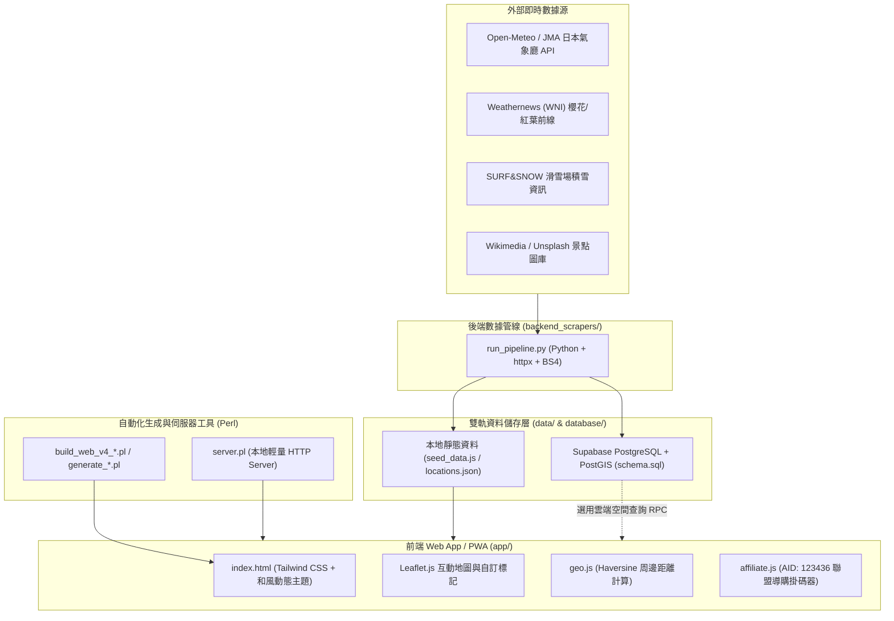

# 日本旅遊報報 (Japan Go App) — 技術架構與開發維護手冊

本文件為「**日本旅遊報報（日本四季玩樂地圖 Web App / PWA）**」的完整技術架構與開發者維護指南，涵蓋系統架構、專案目錄結構、前端核心模組、資料庫空間索引設計、後端爬蟲資料管線，以及本地開發與部署流程。

---

## 一、 系統整體架構總覽

本專案採用「**無伺服器前端優先 (Serverless / Static-First) ＋ 雙軌資料層 (Local JSON / Supabase PostGIS) ＋ 自動化氣象與旅遊爬蟲管線**」的設計模式，確保前端能以零成本部署於各大靜態託管平台（Vercel、Cloudflare Pages、Netlify），同時保有即時數據同步與高轉換率的聯盟行銷導購能力。



---

## 二、 專案目錄與檔案結構

```text
jp_report/
├── app/                          # 前端 Web App / PWA 靜態發佈根目錄
│   ├── index.html                # App 單頁式主程式入口 (整合地圖、篩選器、詳情抽屜與即時狀態)
│   ├── manifest.json             # PWA 安裝描述檔 (支援手機加入主畫面)
│   ├── css/
│   │   └── app.css               # 自訂動畫、毛玻璃效果與捲軸樣式
│   └── js/
│       ├── main.js               # 前端核心互動邏輯、狀態管理與 DOM 渲染
│       ├── geo.js                # 經緯度 Haversine 直線距離計算與同城順遊推薦模組
│       └── affiliate.js          # Klook / Agoda / Booking.com 聯盟行銷網址自動掛碼器
├── backend_scrapers/             # 後端自動化爬蟲與氣象 API 同步腳本
│   ├── requirements.txt          # Python 依賴套件 (httpx, beautifulsoup4 等)
│   └── run_pipeline.py           # 花況 (WNI)、雪況 (JMA/SURF&SNOW) 數據同步主程式
├── config/                       # 全域設定檔
│   └── affiliate.json            # 聯盟行銷夥伴 ID (預設 AID: 123436) 與 UTM 參數設定
├── data/                         # 本地端景點與活動種子資料庫
│   ├── locations.json            # 結構化景點 JSON 資料
│   └── seed_data.js              # 供前端直接載入的 JavaScript 資料物件 (window.JAPAN_GO_DATA)
├── database/                     # 雲端資料庫結構定義
│   └── schema.sql                # Supabase / PostgreSQL + PostGIS 空間資料表與 RPC 函數
├── build_app.pl                  # 第一代前端建置腳本 (Perl)
├── build_app_part2.pl            # 第一代前端建置腳本 Part 2
├── generate_v2*.pl               # V2 版本頁面生成腳本
├── generate_v3*.pl               # V3 版本頁面生成腳本
├── build_web_v4_part1.pl         # V4 最新版前端 index.html 生成腳本 (Part 1: Head、CSS 與骨架)
├── build_web_v4_part2.pl         # V4 最新版前端 index.html 生成腳本 (Part 2: 腳本與收尾)
├── server.pl                     # 零依賴 Perl 本地端 HTTP 預覽伺服器 (預設 Port 8080)
├── API_INTEGRATION_GUIDE.md      # 外部即時數據 API 深度研究與串接指南
├── README.md                     # 專案快速上手與免費部署說明
└── .env.example                  # 環境變數範本 (Affiliate ID、Supabase、Gemini API Key)
```

---

## 三、 前端核心模組設計 (`app/`)

### 1. 動態和風主題系統 (`index.html` & `app.css`)
系統根據使用者當前切換的分類標籤，自動在 `<body>` 切換對應的 CSS 變數主題（定義於 `index.html` 的 `:root` 與 `body.theme-*`）：
- **`theme-spot`（必去景點）**：晴空藍 (`#0284C7`) 搭配和紙米白底色 (`#FAF9F6`)
- **`theme-flower`（花季進度）**：櫻花粉 (`#E11D48`)，凸顯見頃百分比進度條
- **`theme-fireworks`（花火大會）**：夜空琥珀橘 (`#D97706`)，強調施放發數與倒數計時
- **`theme-snow`（冬季滑雪）**：冰川青 (`#0891B2`)，展示積雪厚度與粉雪狀態
- **`theme-cafe`（時令咖啡）**：焙茶棕 (`#92400E`)，呈現季節限定甜點與周邊店鋪

### 2. 地理座標與周邊順遊計算 (`app/js/geo.js`)
透過 `window.GeoHelper` 模組在瀏覽器端進行零延遲的空間運算：
- **`getDistanceKm(lat1, lng1, lat2, lng2)`**：採用 **Haversine 公式**計算地球表面兩組經緯度之間的直線距離（公里）。
- **`formatDistance(km)`**：距離小於 `1 km` 時自動轉換為公尺顯示（以 10 公尺為單位四捨五入，最小顯示 `約 50 公尺`）；大於等於 `1 km` 時顯示小數點後一位公里數（如 `約 2.4 km`）。
- **`findNearbyLocations(centerItem, allLocations, maxCount = 3)`**：自動篩選同一城市 (`item.city === centerItem.city`) 且距離最近的 `N` 個順遊景點與 Klook 門票行程，顯示於詳情抽屜底部，提升交叉導購率。

### 3. 聯盟行銷自動掛碼器 (`app/js/affiliate.js` & `config/affiliate.json`)
透過 `window.AffiliateBuilder` 統一管理所有外部導購連結，確保每一筆點擊都能正確歸因至夥伴 ID（預設 `AID: 123436`）：
- **`buildKlookUrl(rawUrl, subId)`**：
  自動為任何 Klook 網址附加：
  - `aid=123436`
  - `utm_medium=affiliate-alwayson`
  - `utm_source=non-network`
  - `utm_campaign=123436`
  - `aff_label1=<景點ID>`（透過 `subId` 帶入景點識別碼，方便於聯盟後台追蹤哪個景點轉換率最高）
- **`buildHotelAffiliateUrl({ query, lat, lng, platform })`**：
  支援三大訂房平台一鍵轉換（預設使用 Klook 飯店搜尋，亦可切換 `'agoda'` 或 `'booking'`），自動帶入景點周邊地標關鍵字 (`hotel_area_keyword`)，解決旅客看完花火大會或祭典後「散場免擠電車」的住宿需求。

---

## 四、 資料層與資料庫設計 (`data/` & `database/`)

### 1. 景點資料結構 Schema (`data/locations.json`)
每一筆景點物件包含以下核心欄位：

| 欄位名稱 | 型別 | 說明 |
| :--- | :--- | :--- |
| `id` | `String` | 唯一識別碼（例：`tokyo-ueno-sakura`、`osaka-tenjin-fireworks`） |
| `city` | `String` | 城市代碼（`tokyo`、`osaka`、`kyoto`、`hokkaido`、`fukuoka`） |
| `area_zh` | `String` | 繁體中文區域顯示名稱（例：`東京・上野`） |
| `name_zh` / `name_ja` | `String` | 景點中日文名稱 |
| `type` | `String` | 主分類（`flower`、`fireworks`、`event`、`attraction`） |
| `sub_type` | `String` | 子分類（例：`sakura`、`momiji`、`ski`、`cafe`） |
| `lat` / `lng` | `Number` | WGS84 經緯度座標（供 Leaflet 地圖標記與距離計算使用） |
| `status_badge` | `String` | 狀態標籤文字（例：`🌸 滿開見頃 (100%)`） |
| `status_level` | `String` | 狀態代碼（`bud`、`blooming`、`full`、`fubuki`） |
| `progress_pct` | `Number` | 進度百分比 (`0` ~ `100`)，用於渲染卡片進度條 |
| `hotel_area_keyword` | `String` | 導購周邊飯店時自動帶入的搜尋關鍵字 |
| `klook_tickets` | `Array` | 關聯的 Klook 門票/交通券商品清單（含名稱、價格、原始連結） |
| `nearby_hotels` | `Array` | 推薦的周邊高評價景觀飯店清單 |

### 2. Supabase PostgreSQL + PostGIS 雲端空間資料庫 (`database/schema.sql`)
當景點規模擴大或需要伺服器端毫秒級空間檢索時，可將資料匯入 Supabase：
- **PostGIS 地理空間欄位**：
  `geom` 欄位採用 `GENERATED ALWAYS AS (ST_SetSRID(ST_MakePoint(lng, lat), 4326)::geography) STORED`，新增或修改經緯度時會自動計算產生空間點位，並建立 `GIST` 空間索引 (`idx_locations_geom`)。
- **空間查詢 RPC 函數 (`get_nearby_locations`)**：
  前端可直接透過 Supabase Client 呼叫 `supabase.rpc('get_nearby_locations', { user_lat, user_lng, radius_meters: 5000 })`，利用 `ST_DWithin` 與 `ST_Distance` 快速撈出使用者所在位置方圓 5 公里內的所有花季、煙火與 Klook 優惠景點，並依距離由近到遠排序。

---

## 五、 後端爬蟲與即時 API 管線 (`backend_scrapers/`)

後端同步腳本位於 `backend_scrapers/run_pipeline.py`，負責將日本各大權威氣象與觀光網站數據轉換為本專案格式：

1. **花況狀態映射 (`WNI_BLOOM_MAPPING`)**：
   將 Weathernews (WNI) 的日文花況自動映射為本系統的四階段過濾器與百分比：
   - `満開` / `見頃` $\rightarrow$ `("full", 100%, "🌸 滿開見頃")`
   - `7分咲き` / `5分咲き` / `咲き始め` $\rightarrow$ `("blooming", 30%~70%, "🌷 正在開")`
   - `つぼみ` $\rightarrow$ `("bud", 15%, "🌱 準備要開")`
   - `桜吹雪` $\rightarrow$ `("fubuki", 60%, "🍃 櫻吹雪・花筏期")`
2. **雪場即時積雪同步 (`fetch_open_meteo_jma_snow_depth`)**：
   串接免費免金鑰的 **Open-Meteo JMA (日本氣象廳數值模型) API**，傳入滑雪場經緯度即可取得當日每小時積雪深度 (`snow_depth`) 與氣溫，並自動將公尺換算為公分 (`cm`)。

### 執行後端數據同步管線
```bash
# 1. 安裝 Python 依賴套件
pip install -r backend_scrapers/requirements.txt

# 2. 執行數據同步測試
python3 backend_scrapers/run_pipeline.py
```

---

## 六、 本地開發、建置與部署指南

### 1. 本地端啟動預覽方法

#### 方法 A：使用 Python 內建伺服器（最推薦，免修改路徑）
在專案根目錄執行：
```bash
python3 -m http.server 8080 --directory app
```
接著在瀏覽器開啟 `http://127.0.0.1:8080/` 即可完整預覽。

#### 方法 B：直接雙擊開啟
直接在 Finder 雙擊打開 `app/index.html` 即可在瀏覽器離線運行。

#### 方法 C：使用專案內建的 `server.pl`
所有 Perl 腳本（包括 `server.pl` 與各建置腳本）皆已配置 `FindBin qw($Bin)` 動態解析當前腳本所在目錄，因此在任何環境直接執行即可：
```bash
perl server.pl
```
伺服器將自動綁定並伺服 `$Bin/app` 目錄，在瀏覽器開啟 `http://127.0.0.1:8080/` 即可。

### 2. Perl 自動化建置腳本說明
根目錄下的 `.pl` 檔案為各版本迭代時的自動化生成工具：
- `build_app.pl` / `build_app_part2.pl`：初版 App 建置腳本。
- `generate_v2*.pl`、`generate_v3*.pl`：V2 與 V3 版本的介面與資料生成器。
- `build_web_v4_part1.pl` + `build_web_v4_part2.pl`：**目前最新 V4 版本**的生成腳本，依序執行 Part 1（寫入 HTML Header、Tailwind 設定、和風主題 CSS 與主體結構）與 Part 2（附加底部互動 JS 邏輯）即可重新編譯出完整的 `app/index.html`。

### 3. 免費部署上線流程 (Vercel / Cloudflare Pages / Netlify)
1. 將整個專案推送至 GitHub 儲存庫。
2. 登入 **Cloudflare Pages** 或 **Vercel**，匯入該 GitHub 儲存庫。
3. 設定 **Build Output Directory (發佈目錄)** 為 `app`（無需設定 Build Command）。
4. 部署完成後即可獲得免費的 HTTPS 網址（如 `*.pages.dev` 或 `*.vercel.app`），所有聯盟行銷分潤參數 (`aid=123436`) 皆可立即生效。

---

## 七、 日常維護與擴充常見問題 (FAQ)

### Q1：如何更換聯盟行銷夥伴 ID (`AID`)？
只需修改以下兩個位置即可全域生效：
1. `config/affiliate.json` 中的 `"partner_id"` 與 `"aid"`。
2. `app/js/affiliate.js` 第 6 行的 `const DEFAULT_AID = "123436";`（以及 `app/index.html` 內嵌腳本中的對應常數）。

### Q2：如何新增一個新的賞櫻、花火或滑雪景點？
1. 在 `data/locations.json` 與 `data/seed_data.js`（或 `app/index.html` 內的景點資料陣列）新增一筆符合 Schema 的景點物件。
2. 填入正確的 `lat`、`lng` 經緯度座標與 `city` 代碼，地圖標記與「周邊順遊推薦 (`geo.js`)」就會自動將該景點納入計算，無需額外修改前端邏輯。

### Q3：如何設定每日自動更新花況與積雪數據？
可利用 **GitHub Actions** 或主機端的 **CronJob**，於每日台灣時間清晨 `07:30` 定時執行 `python3 backend_scrapers/run_pipeline.py`，將最新抓取的 JSON 寫回 `data/` 並自動觸發靜態網站重新部署。

